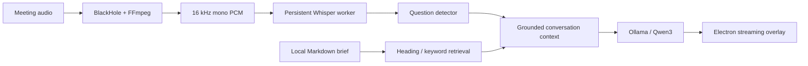

# OpenCluely

### A local-first desktop copilot for prepared conversations

[](package.json)
[](package.json)
[](src/native/whisper_streaming_worker.py)
[](src/services/ollama.service.js)
[](LICENSE)

OpenCluely brings a Markdown call brief, local speech transcription, and streamed AI answers into an Electron desktop overlay. Load the facts you want to discuss, choose an answer style, and use the local call workflow to retrieve relevant context while you speak.

This is **Afnan Mehmood Awan’s modified distribution** of [TechyCSR/OpenCluely](https://github.com/TechyCSR/OpenCluely). The original project supplies the desktop assistant foundation; this version adds a local call-brief and live-audio workflow. See [attribution](NOTICE).

> **Status:** development source release. The live-call path targets macOS, especially Apple Silicon. Windows/Linux packaging scripts exist, but the BlackHole/AVFoundation live-audio workflow and current Python worker path are macOS-specific. No signed installer or verified cross-platform live-call release is included.

[Quick start](#quick-start-macos) · [How to use](#how-to-use) · [Architecture](docs/ARCHITECTURE.md) · [Models and configuration](docs/CONFIGURATION.md) · [Troubleshooting](docs/TROUBLESHOOTING.md) · [Privacy](SECURITY.md)

## What it does

| Capability | Implementation |
|---|---|
| Bring your own conversation context | Load a local `.md` / `.markdown` brief, up to 2 MB |
| Retrieve relevant facts | Heading-aware local keyword retrieval, with restricted-claim sections prioritized |
| Transcribe live audio | BlackHole → FFmpeg → persistent Python/OpenAI Whisper worker |
| Generate local answers | Ollama HTTP streaming, preferring `qwen3:1.7b-q4_K_M` |
| Shape the response | Short/very-short/standard lengths and selectable conversational styles |
| Reset a conversation | End-call and purge controls clear the in-memory brief/session state |
| Optional cloud assistance | Gemini screenshot/text processing and Azure Speech integration |
| Desktop interaction | Electron windows, chat overlay, keyboard controls and settings |

The project does not train a new language or speech model. It integrates existing inference runtimes with audio capture, document retrieval, session state, and a desktop interface. Model availability, machine performance, and permission state affect results; there are no benchmark or zero-latency guarantees.

## Quick start (macOS)

Prerequisites: Node.js 22 LTS, npm, Python 3.11, Homebrew, and enough disk space for Python dependencies and downloaded model weights. The commands below install the local audio/AI path. Install [Ollama](https://ollama.com/download) first, then start its desktop app (or run `ollama serve` in another terminal).

```bash
git clone https://github.com/awanafnan17/OpenCluely.git
cd OpenCluely
npm ci
cp env.example .env

brew install python@3.11 ffmpeg sox blackhole-2ch
python3.11 -m venv .venv-whisper
.venv-whisper/bin/python -m pip install --upgrade pip
.venv-whisper/bin/python -m pip install openai-whisper

ollama pull qwen3:1.7b
# Preload speech weights before the app's timed startup check:
.venv-whisper/bin/python -c "import whisper; whisper.load_model('base.en', device='cpu', download_root='.whisper-models')"
npm start
```

BlackHole installation may require a restart. You do not need a Gemini or Azure key to use the local Ollama call workflow. The optional legacy microphone Whisper CLI may need the virtual environment on your PATH, or its absolute executable path in Settings. The separate live-call worker uses `.venv-whisper/bin/python` directly.

### Route meeting audio

1. Open **Audio MIDI Setup** on macOS.
2. Create a **Multi-Output Device** containing your speakers/headphones and **BlackHole 2ch**.
3. Use matching sample rates and enable drift correction for the secondary device.
4. Select that Multi-Output Device as the Mac's sound output, so you can hear the audio while BlackHole receives it.
5. Open OpenCluely. Grant Microphone/Screen Recording permissions when a feature requests them, then restart the app if macOS requires it.

Use audio and meeting assistance only where you have permission to capture the conversation. Test routing with non-sensitive sample audio before a real session.

## How to use

1. **Start the app** with `npm start` and open the call-copilot controls.
2. **Check Ollama** and confirm that a model is ready. The application connects to `127.0.0.1:11434`.
3. **Load a brief** using the Markdown file picker, or create a brief template. Include project facts, your responsibilities, approved claims, and things you must not promise.
4. **Set the style and length** appropriate to the conversation. A short answer is the default.
5. **Try a typed question** about the brief first. Check that the answer reflects the actual facts.
6. **Start Live Call** after audio routing is ready. The app transcribes audio, detects questions and streams the answer into the UI.
7. **End Call & Purge** when finished. This resets in-memory call state; it is not a secure deletion of local logs or source briefs.

Example brief — fictional content:

```markdown
# Atlas Dashboard discussion

## Project facts
A demonstration dashboard built with React and Node.js.

## My responsibilities
I implemented the chart interface and telemetry API.

## Claims I must not make
Do not invent customer counts, performance metrics, or deployment history.

## Tone and speaking style
Explain the implementation in short, plain-English answers.
```

Keep private briefs outside this repository. The included `tests/fixtures` are synthetic examples for repeatable tests.

## Architecture



The local flow keeps inference on the machine. Optional Gemini/Azure routes send selected data to their providers. Logs may contain prompts, transcriptions, filenames and responses; see [privacy details](SECURITY.md).

## Technology and model map

| Layer | Technology / model | Role |
|---|---|---|
| Desktop | Electron 29, Node.js, JavaScript, HTML/CSS | Windows, permissions, IPC, chat controls |
| Audio | FFmpeg, BlackHole 2ch, AVFoundation | Capture and normalize system audio |
| Transcription | `openai-whisper`, PyTorch, **`base.en`** | Persistent live-call transcription; CPU or MPS |
| Local generation | Ollama, **Qwen3 1.7B**, preferred Q4_K_M tag | Stream short context-grounded responses |
| Retrieval | Custom JavaScript lexical scoring | Select relevant Markdown sections; no vector database required |
| Optional cloud | `@google/genai`, Azure Speech SDK | Gemini assistance / alternate speech recognition |
| Experimental native capture | Swift + ScreenCaptureKit | Alternate audio-capture implementation |
| Verification | Node assertions, Playwright | Logic checks and hardware-dependent app tests |

The legacy microphone route defaults to Whisper `turbo`; it is separate from the live-call `base.en` worker. Read the [configuration guide](docs/CONFIGURATION.md) before changing models.

## Repository layout

```text
main.js                 Electron lifecycle and IPC coordination
preload.js              Restricted renderer bridge
src/core/               Configuration, logging, first-run setup
src/managers/           Windows, session state, call briefs
src/services/           Audio, transcription, retrieval, LLM services
src/native/             Python Whisper worker and Swift helper
src/ui/                 Renderer interactions
prompts/                Prompt templates
scripts/                Setup and focused verification helpers
tests/                  Logic and application checks
docs/                   Architecture, setup detail and troubleshooting
```

## Verify and develop

```bash
npm test
node --check main.js
python3 -m py_compile src/native/whisper_streaming_worker.py
```

`npm test` runs the offline retrieval and call-brief lifecycle tests. Other tests in `tests/` and `scripts/` have different prerequisites: some need a running Ollama server, Electron, microphone access or system audio. Passing offline checks does not prove a live meeting works end to end. Packaging uses `npm run build:mac`; native signing/notarization and a complete packaged model-runtime installation remain release work.

## Current limitations

- Live audio is macOS-specific; native capture remains experimental.
- Whisper first-time model downloads can exceed the worker's startup timeout; pre-download as shown above.
- Small local models can misunderstand questions or add unsupported claims. Review answers before relying on them.
- Optional cloud model identifiers are stored in source and may need updating for your provider account.
- Permission, virtual-audio and packaged-app behavior require a real-machine smoke test.
- No model weights, private call history, secret keys, database files or original Git history are shipped.

## Credits and license

Maintained and extended by [Afnan Mehmood Awan](https://github.com/awanafnan17). Built on [TechyCSR/OpenCluely](https://github.com/TechyCSR/OpenCluely). Distributed under the retained [Apache License 2.0](LICENSE). Third-party tools, libraries and downloaded models carry their own licenses.
