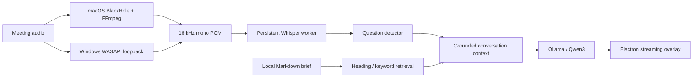

# OpenCluely

### A local-first desktop copilot for prepared conversations

[](package.json)
[](package.json)
[](src/native/whisper_streaming_worker.py)
[](src/services/ollama.service.js)
[](LICENSE)

OpenCluely brings a Markdown call brief, local speech transcription, and streamed AI answers into an Electron desktop overlay. Load the facts you want to discuss, choose an answer style, and use the local call workflow to retrieve relevant context while you speak.

OpenCluely is maintained and extended by **Afnan Mehmood Awan**. This version adds a local call-brief and live-audio workflow to the desktop assistant. License and original-author credits are preserved in [NOTICE](NOTICE).

> **Status:** development source release for macOS and Windows. The Windows system-audio path uses WASAPI loopback; the macOS path uses BlackHole or optional ScreenCaptureKit. Windows source checks run in CI, but live device capture still needs a Windows hardware test. Signed installers are not included.

[macOS setup](#macos-setup) · [Windows setup](#windows-setup) · [How to use](#how-to-use) · [Hardware and latency](#hardware-and-latency) · [Architecture](docs/ARCHITECTURE.md) · [Troubleshooting](docs/TROUBLESHOOTING.md) · [Privacy](SECURITY.md)

## What it does

| Capability | Implementation |
|---|---|
| Bring your own conversation context | Load a local `.md` / `.markdown` brief, up to 2 MB |
| Retrieve relevant facts | Heading-aware local keyword retrieval, with restricted-claim sections prioritized |
| Transcribe live audio | macOS: BlackHole/FFmpeg; Windows: WASAPI loopback; both feed a persistent Whisper worker |
| Generate local answers | Ollama HTTP streaming, preferring `qwen3:1.7b-q4_K_M` |
| Shape the response | Short/very-short/standard lengths and selectable conversational styles |
| Reset a conversation | End-call and purge controls clear the in-memory brief/session state |
| Optional cloud assistance | Gemini screenshot/text processing and Azure Speech integration |
| Desktop interaction | Electron windows, chat overlay, keyboard controls and settings |

The project does not train a new language or speech model. It integrates existing inference runtimes with audio capture, document retrieval, session state, and a desktop interface. Model availability, machine performance, and permission state affect results; there are no benchmark or zero-latency guarantees.

## macOS setup

Prerequisites: Node.js 22 LTS, npm, Python 3.11, Homebrew, and enough disk space for Python dependencies and downloaded model weights. The commands below install the local audio/AI path. Install [Ollama](https://ollama.com/download) first, then start its desktop app (or run `ollama serve` in another terminal).

```bash
git clone https://github.com/awanafnan17/OpenCluely.git
cd OpenCluely
npm ci
cp env.example .env

brew install python@3.11 ffmpeg sox blackhole-2ch
python3.11 -m venv .venv-whisper
.venv-whisper/bin/python -m pip install --upgrade pip
.venv-whisper/bin/python -m pip install openai-whisper

ollama pull qwen3:1.7b
# Preload speech weights before the app's timed startup check:
.venv-whisper/bin/python -c "import whisper; whisper.load_model('base.en', device='cpu', download_root='.whisper-models')"
npm start
```

BlackHole installation may require a restart. You do not need a Gemini or Azure key to use the local Ollama call workflow. The optional legacy microphone Whisper CLI may need the virtual environment on your PATH, or its absolute executable path in Settings. The separate live-call worker uses `.venv-whisper/bin/python` directly.

### Route meeting audio

1. Open **Audio MIDI Setup** on macOS.
2. Create a **Multi-Output Device** containing your speakers/headphones and **BlackHole 2ch**.
3. Use matching sample rates and enable drift correction for the secondary device.
4. Select that Multi-Output Device as the Mac's sound output, so you can hear the audio while BlackHole receives it.
5. Open OpenCluely. Grant Microphone/Screen Recording permissions when a feature requests them, then restart the app if macOS requires it.

Use audio and meeting assistance only where you have permission to capture the conversation. Test routing with non-sensitive sample audio before a real session.

## Windows setup

**Requirements:** Windows 10/11 64-bit, Node.js 22 LTS, Python 3.11 with the `py` launcher, Ollama for Windows, and PowerShell. Download/install those tools first and reopen PowerShell so they are on PATH. A local Ollama server must be running before you start a live call.

```powershell
git clone https://github.com/awanafnan17/OpenCluely.git
cd OpenCluely
powershell -ExecutionPolicy Bypass -File .\scripts\setup-windows.ps1
npm start
```

The setup script installs Node dependencies, creates `.venv-whisper`, installs OpenAI Whisper and SoundCard, pulls Qwen3 1.7B, downloads Whisper `base.en`, and creates an uncommitted `.env` with placeholder values. The local call workflow needs no Gemini or Azure key.

In the call panel, choose **System audio (WASAPI loopback)** to listen to the Windows default playback device. Play a short sample through that device before starting the call. If you change headphones or speakers, refresh the source and restart capture. **Default microphone** is a separate choice for nearby speech. The app does not automatically mix both inputs into one transcript. If an interview uses headphones, system audio captures the remote speaker while the microphone choice captures your own voice; choose the one appropriate to your use.

Windows audio capture uses the Python package `soundcard` and does not require BlackHole or FFmpeg for the live system-audio route. If SoundCard cannot open the output device, check Windows Sound output selection, app permissions, the device driver, and [troubleshooting](docs/TROUBLESHOOTING.md). The source checks run on Windows in GitHub Actions; a full real-device live-call test is still needed before relying on it.

## How to use

1. **Start the app** with `npm start` and open the call-copilot controls.
2. **Check Ollama** and confirm that a model is ready. The application connects to `127.0.0.1:11434`.
3. **Load a brief** using the Markdown file picker, or create a brief template. Include project facts, your responsibilities, approved claims, and things you must not promise.
4. **Set the style and length** appropriate to the conversation. A short answer is the default.
5. **Try a typed question** about the brief first. Check that the answer reflects the actual facts.
6. **Start Live Call** after audio routing is ready. The app transcribes audio, detects questions and streams the answer into the UI.
7. **End Call & Purge** when finished. This resets in-memory call state; it is not a secure deletion of local logs or source briefs.

Example brief — fictional content:

```markdown
# Atlas Dashboard discussion

## Project facts
A demonstration dashboard built with React and Node.js.

## My responsibilities
I implemented the chart interface and telemetry API.

## Claims I must not make
Do not invent customer counts, performance metrics, or deployment history.

## Tone and speaking style
Explain the implementation in short, plain-English answers.
```

Keep private briefs outside this repository. The included `tests/fixtures` are synthetic examples for repeatable tests.

## Architecture



The local flow keeps inference on the machine. Optional Gemini/Azure routes send selected data to their providers. Logs may contain prompts, transcriptions, filenames and responses; see [privacy details](SECURITY.md).

## Technology and model map

| Layer | Technology / model | Role |
|---|---|---|
| Desktop | Electron 29, Node.js, JavaScript, HTML/CSS | Windows, permissions, IPC, chat controls |
| Audio | macOS: FFmpeg, BlackHole 2ch, AVFoundation; Windows: SoundCard/WASAPI | Capture and normalize system audio |
| Transcription | `openai-whisper`, PyTorch, **`base.en`** | Persistent live-call transcription; CPU, MPS or CUDA |
| Local generation | Ollama, **Qwen3 1.7B**, preferred Q4_K_M tag | Stream short context-grounded responses |
| Retrieval | Custom JavaScript lexical scoring | Select relevant Markdown sections; no vector database required |
| Optional cloud | `@google/genai`, Azure Speech SDK | Gemini assistance / alternate speech recognition |
| Experimental native capture | Swift + ScreenCaptureKit | Alternate audio-capture implementation |
| Verification | Node assertions, Playwright | Logic checks and hardware-dependent app tests |

The legacy microphone route defaults to Whisper `turbo`; it is separate from the live-call `base.en` worker. Read the [configuration guide](docs/CONFIGURATION.md) before changing models.

## Hardware and latency

| Component | Practical baseline | More comfortable setup |
|---|---|---|
| Operating system | 64-bit Windows 10/11 or recent macOS | Current Windows 11 or Apple Silicon macOS |
| Processor | Modern 4-core CPU | Apple Silicon or modern 6-core CPU |
| Memory | 8 GB RAM for local Qwen3 1.7B + Whisper `base.en` | 16 GB RAM for steadier multitasking |
| GPU | None required; CPU inference works | Apple Silicon MPS or NVIDIA CUDA-capable GPU with at least ~2 GB free VRAM for the speech model |
| Disk | About 5 GB free beyond the operating system | 10 GB free for packages, Python/PyTorch, caches, models and builds |
| Audio | Working default microphone or playback device | Wired headset/speakers and verified system-audio routing |

These are practical planning figures, not benchmarked minimum specifications. [Whisper lists about 1 GB of VRAM for `base.en`](https://pypi.org/project/openai-whisper/); the [Qwen3 1.7B Ollama download is about 1.4 GB](https://ollama.com/library/qwen3:1.7b). Python/PyTorch, Electron, operating-system buffers and the Ollama runtime require extra memory and disk. An 8 GB machine can run the tested local models but may slow down when other apps compete for memory.

**Measured on an Apple M2 with 8 GB RAM, using a 5.05-second synthetic spoken question and a short fictional project answer:**

| Stage | Observed time | What it means |
|---|---:|---|
| Silence endpoint | 280 ms configured | Worker waits for a pause after speech |
| Whisper `base.en` load | 3.21 s once | Startup, before the call is active |
| Whisper transcription | 3.36 s first inference; 0.18–0.22 s for two subsequent runs | Time after the complete 5.05 s audio sample was supplied |
| Warm Qwen3 1.7B first answer token | 0.14–0.41 s across three runs | After a 170-character context-grounded answer request |
| Warm Qwen3 1.7B full answer | 0.69–0.97 s across three runs | Same three requests |
| Cold Qwen3 first token | 4.52 s in a separate short-prompt run | Model load matters when not prewarmed |

These are **component measurements**, not an end-to-end live-call guarantee. Actual delay also includes device buffering, audio routing, question detection, brief retrieval, concurrency and display. The 5.05 seconds of speech occur before the transcription stage. With both models warm, the measured component timings suggest roughly **0.6–0.9 seconds from speech end to first answer token** and **1.2–1.5 seconds to a short completed answer**, before unmeasured capture/display overhead. Windows latency is **not measured yet**; CPU-only systems can be substantially slower. Run the supplied [latency benchmark](docs/LATENCY.md) on your own hardware and test a full call before relying on those figures.

## Repository layout

```text
main.js                 Electron lifecycle and IPC coordination
preload.js              Restricted renderer bridge
src/core/               Configuration, logging, first-run setup
src/managers/           Windows, session state, call briefs
src/services/           Audio, transcription, retrieval, LLM services
src/native/             Python Whisper worker and Swift helper
src/ui/                 Renderer interactions
prompts/                Prompt templates
scripts/                Setup and focused verification helpers
tests/                  Logic and application checks
docs/                   Architecture, setup detail and troubleshooting
```

## Verify and develop

```bash
npm test
node --check main.js
python3 -m py_compile src/native/whisper_streaming_worker.py
```

`npm test` runs offline retrieval, call-brief lifecycle and Windows PCM framing tests. Other tests in `tests/` and `scripts/` have different prerequisites: some need a running Ollama server, Electron, microphone access or system audio. Passing offline checks does not prove a live meeting works end to end. Use `npm run build:mac` or `npm run build:win` for platform packages. CI builds unsigned Windows installer artifacts; code signing/notarization and bundling a complete Python/model runtime remain release work.

## Current limitations

- Windows WASAPI capture is implemented but awaits a real Windows audio-device smoke test; CI covers source and offline logic.
- Whisper first-time model downloads can exceed the worker's startup timeout; pre-download as shown above.
- Small local models can misunderstand questions or add unsupported claims. Review answers before relying on them.
- Optional cloud model identifiers are stored in source and may need updating for your provider account.
- Permission, virtual-audio and packaged-app behavior require a real-machine smoke test.
- No model weights, private call history, secret keys, database files or original Git history are shipped.

## Credits and license

Maintained and extended by [Afnan Mehmood Awan](https://github.com/awanafnan17). Distributed under the retained [Apache License 2.0](LICENSE), with original-author credits in [NOTICE](NOTICE). Third-party tools, libraries and downloaded models carry their own licenses.
